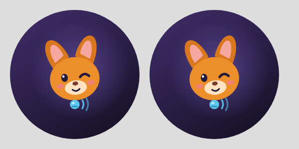

# Nooki

**A small fox who pays attention for you.**

---

Nooki answers three questions every time you open it:

- **You missed** — calls, messages and reminders that slipped past.
- **You forgot** — bills, birthdays, expiring things and leftovers from yesterday.
- **To do** — what is still ahead today.

The Today screen draws these as one thread with knots: vermilion for missed, marigold for
forgot, indigo for to do, and leaf green once something is done. Untie a knot to finish it, or
push it to tomorrow.

## Tell Nooki

One text box understands plain English, Hinglish and Hindi:

- `doctor kal subah 9 baje` → a reminder tomorrow at 9 am
- `rent on the 1st every month` → a monthly bill with heads-ups
- `Physics exam on Friday at 10am` → an exam with week, day and two-hour warnings
- `Rahul ko 500 diye` → money you lent, kept until it is settled
- `wifi password is sunflower42` → a saved thing you can ask for later
- `wifi password kya hai?` → Nooki answers from what you saved

You can also share text into Nooki, select text in any app and pick "Tell Nooki", use the
quick settings tile, the launcher shortcut, or voice input (English or Hindi).

## Noticing, and the trust rules

If you turn it on, Nooki can notice missed calls, unread messages and bills from your
notifications. The rules are strict and covered by tests:

- Nooki has **no internet permission**. The build fails if one ever appears.
- **Message content is never stored**, only who and when.
- **OTPs, PINs, passwords, CVVs and balances are never stored**, in English or Hindi.
- Noticed items are **suggestions until you tap them**.
- Each kind of noticing has its own switch, and off means off.
- Exact alarms are used only for medicine and critical items. Everything else uses gentler
  inexact alarms.
- Every database change ships with a tested migration. Your data is never wiped.

There is no login, cloud, AI chat, ads or location.

## Daily rhythm

A short morning note says what today holds. An evening wrap offers to move leftovers to
tomorrow and nudges you to charge your phone if the battery is low. A home screen widget shows
Nooki's mood and the next thing due.

## Tech

Kotlin, Jetpack Compose (Material 3), Room with exported schemas, DataStore, AlarmManager,
NotificationListenerService, Glance widget, MVI. The parsing and decision logic lives in
plain Kotlin under `com.example.core` with no Android imports, so it is fully unit tested.
The 3D fox uses SceneView / Filament. Fonts are Baloo 2 and Mukta, both with Devanagari.

## Build

CI builds a signed APK on every push. To build locally, see
[docs/BUILD_AND_INSTALL.md](docs/BUILD_AND_INSTALL.md).
