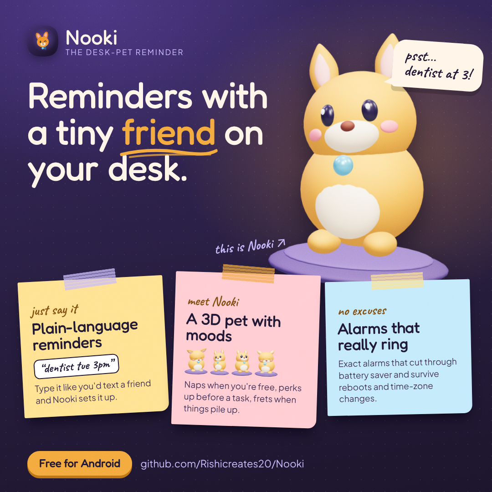
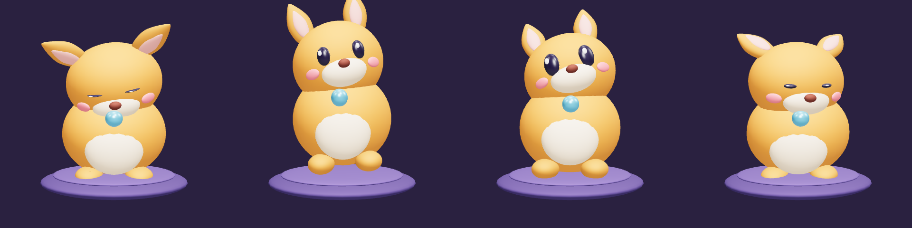
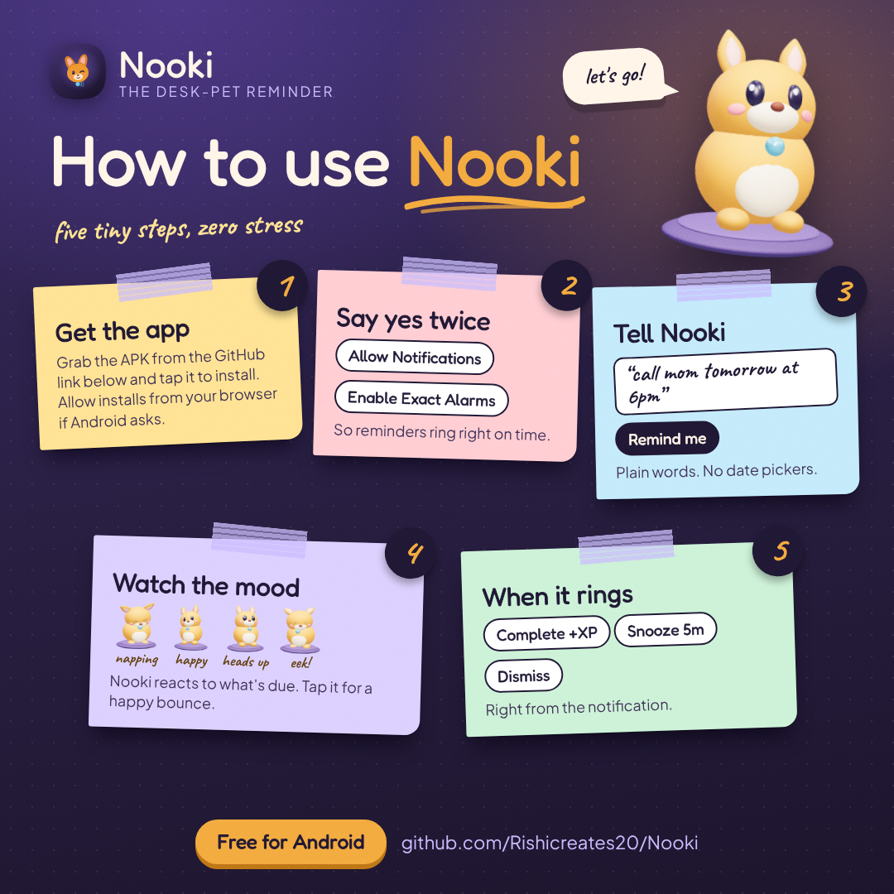
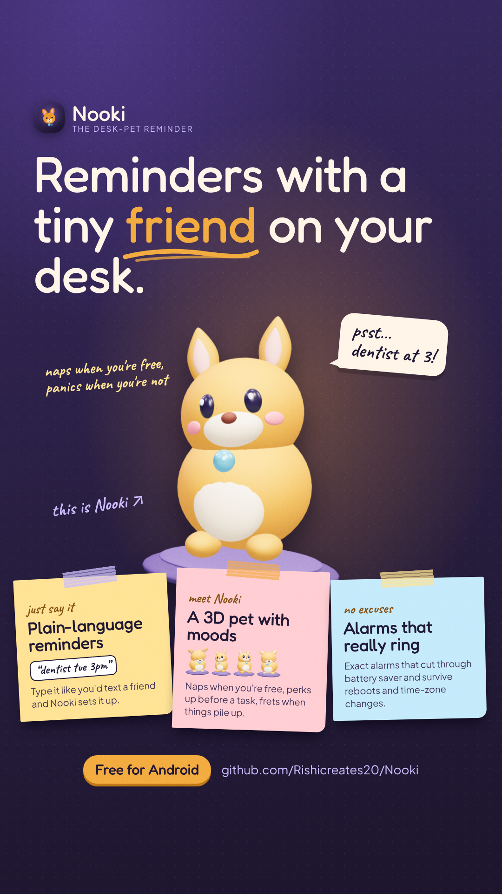
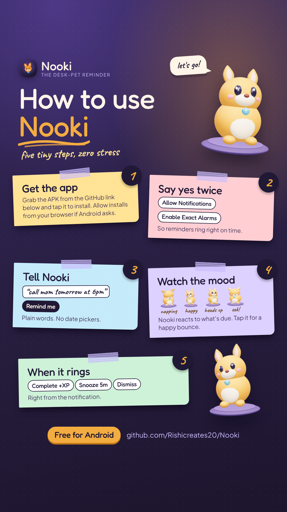

<div align="center">


# Nooki: The Desk-Pet Reminder

**A native Android reminder app with a real-time 3D companion who reacts to your schedule.**

[](https://github.com/Rishicreates20/Nooki/actions/workflows/android-apk.yml)


</div>

---

<p align="center">
  
</p>

Nooki sits on your desk, which here means your home screen. It naps when nothing is due, perks up
when a reminder is coming, and gets visibly flustered when tasks pile up. Reminders fire on time
through exact alarms, and they survive reboots, time-zone changes and app updates.

<p align="center">
  
  <br/>
  <sub>Sleeping · Happy · Alert · Overwhelmed. These are rendered from the bundled glTF model.</sub>
</p>

## Contents

- [How to use Nooki](#how-to-use-nooki)
- [Get the app](#get-the-app)
- [Features](#features)
- [Tech stack](#tech-stack) · [Architecture](#architecture)
- [Custom 3D models](#custom-3d-models) · [Tests](#tests) · [Roadmap](#roadmap)
- [Share Nooki](#share-nooki)

## How to use Nooki

<table>
<tr>
<td width="50%"></td>
<td>

1. **Get the app.** Download the APK (see [Get the app](#get-the-app)) and tap it to install.
   Allow installs from your browser or file manager if Android asks.
2. **Say yes twice.** Tap **Allow Notifications** and **Enable Exact Alarms** so reminders ring
   on time, even in battery saver.
3. **Tell Nooki.** Add a reminder with a title and a time. With quick add
   ([#3](https://github.com/Rishicreates20/Nooki/pull/3), in review) you just type
   *"call mom tomorrow at 6pm"* and tap **Remind me**.
4. **Watch the mood.** Nooki reacts to what's due. Tap it for a happy bounce.
5. **When it rings,** pick **Complete** (+XP), **Snooze 5m** or **Dismiss** straight from the
   notification.

</td>
</tr>
</table>

## Get the app

### Download a build

Every push to `main` (and every pull request) builds APKs on GitHub. Open the latest successful
[Build APK run](https://github.com/Rishicreates20/Nooki/actions/workflows/android-apk.yml),
download the `nooki-apk-…` artifact, unzip it on your phone and open `app-debug.apk`.

### Build it yourself

```bash
git clone https://github.com/Rishicreates20/Nooki.git && cd Nooki
./gradlew :app:assembleDebug
adb install -r app/build/outputs/apk/debug/app-debug.apk
```

Release signing, per-ABI APKs and sideloading troubleshooting are covered in
[docs/BUILD_AND_INSTALL.md](docs/BUILD_AND_INSTALL.md).

## Features

- **Plain-language quick add** *(in review, [#3](https://github.com/Rishicreates20/Nooki/pull/3))*.
  Type a reminder the way you'd text a friend, like "dentist tue 3pm", and Nooki works out the
  date and time.
- **Real-time 3D companion.** An original glTF model rendered with SceneView (Filament). It has
  four mood animations, a spring squash-and-stretch with haptics when you tap it, and a lean that
  follows your phone's tilt via the gravity sensor.
- **Moods driven by your schedule.** `PetMoodResolver` derives Nooki's state from the reminders
  stored in Room, and that state drives the pet, the card colors and the mood badge. Tapping the
  pet briefly plays a Happy reaction on top of the current mood.
- **Exact, reliable alarms.** Uses `AlarmManager.setAlarmClock`, which wakes the device through
  Doze. If the Android 12+ exact-alarm permission is revoked, it falls back to
  `setAndAllowWhileIdle`. Alarms are restored after boot, package replace and time/time-zone
  changes.
- **Actionable notifications.** Complete (+XP), Snooze 5m and Dismiss straight from the
  notification.
- **XP and levels.** Completing reminders earns XP based on priority.
- **Considered design.** Asymmetric card shapes, a mood badge whose `RoundedPolygon` shape morphs
  between moods, contextual color shifts, spring physics, and Fredoka + Plus Jakarta Sans
  typography.
- **Adaptive icon** with a themed (monochrome) layer for Android 13+.

## Tech stack

| Area | Choice |
| --- | --- |
| Language / UI | Kotlin 2.2, Jetpack Compose, Material 3 |
| Persistence | Room (KSP) with reactive `Flow`s, the single source of truth |
| Scheduling | `AlarmManager.setAlarmClock` with an inexact fallback, `BroadcastReceiver`s with `goAsync()` |
| 3D | SceneView 2.3 on Google Filament + gltfio |
| Shapes | `androidx.graphics:graphics-shapes` (`RoundedPolygon`, `Morph`) |
| Build | AGP 9, Gradle 9.3, R8 + resource shrinking, optional ABI splits |
| CI | GitHub Actions: unit tests, lint, and debug + release APK artifacts |

## Architecture

```
Room (ReminderDao) ──Flow──▶ ReminderRepository ──▶ Compose UI (state hoisted, UDF)
        ▲                          │                      │
        │                          ▼                      ▼
 Boot/Time receivers ◀── ExactAlarmScheduler      PetMoodResolver ──▶ NookiPet3D + MoodBadge
 Alarm/Action receivers ─────────────┘
```

- `data/`: Room entity, DAO, database and repository. Every state change goes through Room.
- `scheduler/`: exact alarm scheduling, notification channel, and the alarm, action and boot
  receivers.
- `pet/`: `PetMood` + `PetMoodResolver` (pure, unit-tested) and the `NookiPet3D` composable.
- `ui/`: theme, typography and reusable components.
- `tools/`: stdlib-only Python scripts that generate the 3D model and the launcher icon.

## Custom 3D models

Drop your own `.glb` into `app/src/main/assets/models/` and name its clips `Sleeping`, `Happy`,
`Alert` and `Overwhelmed` (common aliases like `Idle` or `Jump` also work). See
[the models README](app/src/main/assets/models/README.md). To regenerate the bundled pet or the icon:

```bash
python3 tools/pet-model/generate_nooki_glb.py
python3 tools/icon/generate_icon.py
```

## Tests

```bash
./gradlew :app:testDebugUnitTest   # includes PetMoodResolverTest
./gradlew :app:lintDebug           # report: app/build/reports/lint-results-debug.html
```

## Roadmap

- [ ] Full UI theme overhaul (tonal elevation, glass surfaces, tactile components)
- [ ] Home-screen Glance widget showing Nooki's mood
- [ ] Guided setup for OEM battery restrictions ([dontkillmyapp.com](https://dontkillmyapp.com))

## Share Nooki

Ready-made images for social posts, sized for feeds (1080×1080) and stories (1080×1920). Click any
of them to open the full-size PNG.

<p align="center">
  <a href="docs/images/nooki-poster-story-1080x1920.png"></a>
  &nbsp;
  <a href="docs/images/nooki-howto-story-1080x1920.png"></a>
</p>

| Image | Size | Use it for |
| --- | --- | --- |
| [nooki-poster-square-1080.png](docs/images/nooki-poster-square-1080.png) | 1080×1080 | Feed post introducing Nooki |
| [nooki-poster-story-1080x1920.png](docs/images/nooki-poster-story-1080x1920.png) | 1080×1920 | Story or Reel cover |
| [nooki-howto-square-1080.png](docs/images/nooki-howto-square-1080.png) | 1080×1080 | Feed post with the five setup steps |
| [nooki-howto-story-1080x1920.png](docs/images/nooki-howto-story-1080x1920.png) | 1080×1920 | Story with the five setup steps |

---

<sub>Built by <a href="https://github.com/Rishicreates20">Rishi</a>. The model, icon and code in
this repository are original.</sub>
